# PitStudio module map

Companion of [`modules.yaml`](modules.yaml) (the machine-readable source, DC-000-06) and of the foundation spec ([spec.md](spec.md), FR-000-20 to FR-000-23). It lists every module of the product, the contracts that cross module boundaries, and the producer-to-consumer edges between them as a directed acyclic graph, so that every area can be built in parallel against a contract and its fixture. Sizes and effort per module are in [dimensioning.md](dimensioning.md).

## 1. How to read it

- A **module** is a unit that owns code or a published file: a runner stage, a solver, a trainer, a browser engine, a web route group, a build tool. Its fields are `id`, `spec` (the owning feature spec), `env` (the Python or Node environment it runs in), `gpu` (it needs the local CUDA GPU under the runner lock), `inputs` and `outputs` (contract names).
- A **contract** is one schema-described document or file format. Its name is the schema file name without `.schema.json`; `schema_state` is `promoted` (a file under `contracts/`), `draft` (the file under `specs/NNN-*/contracts/`, to be promoted by the spec's first task), `derived` (generated from other schemas) or `none` (no schema exists).
- An **edge** is `producer -> consumer` for one contract. Edges are taken from the `Producer -> Consumer` column of the 112 data-contract rows (DC rows) of the feature specs; where a spec lists several producers or consumers, each pair is an edge. Edges that no DC row declares but that cross modules are listed with `schema_state: none` and a `gap_class`:
  - `binary-format`: the contract is a standard binary format and its validator (a PyTorch checkpoint, an ONNX file, OpenUSD layers, a PLY or SPZ splat, a TensorRT engine);
  - `undefined`: a structured document whose fields no DC row defines (predictions, answer files, surfaces, the ONNX I/O description of two models).
- The `real`, `fixture`, `partial`, `stale`, `invalid` and `absent` behaviour of each edge is the `availability` block of the edge in `modules.yaml` and section 6 below.
- **Environment split.** A cycle-free graph needs a module boundary wherever a request returns to its sender, so three bidirectional interactions are modelled as one-way flows: the console is two modules (`console-api` reads, `console-jobs` writes into the runner queue); the runner is split into `runner-core` (plan, launch), `stagekit` (the stage side) and `runner-store` (promotion, manifests); `s05_synthesize` and `s10_preprocess` are split by domain (a synthetic generator for sensors feeds on renders that need the scene stages, while another feeds the pit planner that the scene stages need).

## 2. Summary

| Item | Count |
|---|---|
| Modules (including 3 external actors) | 147 |
| Edges | 392 |
| Contracts (names) | 134 |
| Data-contract rows in the feature specs (active) | 113 (3 retired: DC-008-01, DC-013-06, DC-019-01) |
| DC rows that appear as an edge | 112 of 113 |
| Edges by schema state | promoted 8, draft 335, derived 13, none 36 |
| DC contract names by schema state | promoted 1, draft 115, derived 4 |
| Modules that need the GPU | 28 |
| Modules per environment | external 3, pipeline 47, pipeline/accel 2, root 21, studio 17, studio/isaac 4, studio/isaaclab 2, studio/rtx 3, web 48 |
| Modules per kind | actor 3, api 2, docs 2, engine 25, eval 12, export 3, infer 4, ingestion 16, lib 7, probe 2, release 2, route 11, runner 5, sdg 2, solver 14, stage 16, tool 12, train 8, ui 1 |
| Modules per build track | A 44, B 31, C 18, D 47, E 2, F 2, None 3 (None: the actors) |

Track letters follow the parallel build tracks: A data and simulation, B models, C logic, APIs and connectors, D web, E docs, F release and deploy.

## 3. Whole-system diagram

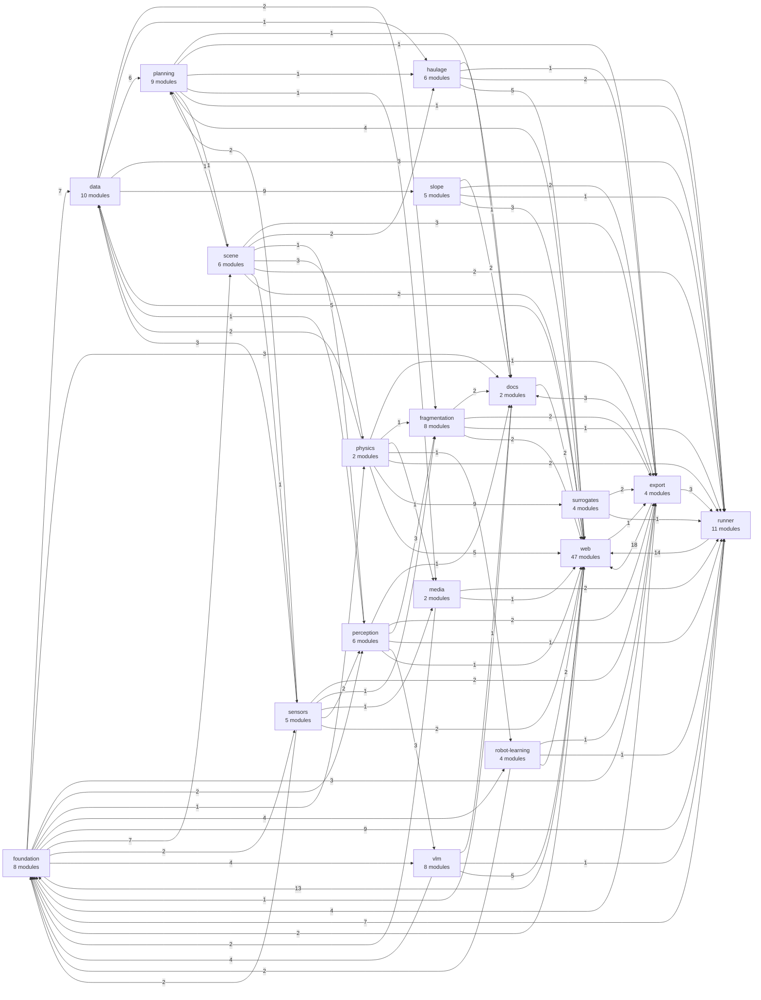

Each arrow is the number of module-to-module edges between two areas. The graph has no cycle.

## 4. Areas

### Foundation: contracts, guards, CI

```mermaid
flowchart LR
  actor_maintainer["actor-maintainer"]
  actor_tests["actor-tests"]
  ci_guards["ci-guards"]
  ci_lane_check["ci-lane-check"]
  ci_pages_deploy["ci-pages-deploy"]
  contracts_gen_py["contracts-gen-py"]
  contracts_gen_ts["contracts-gen-ts"]
  contracts_validate["contracts-validate"]
  console_api(["console-api<br/>runner"])
  console_jobs(["console-jobs<br/>runner"])
  console_ui(["console-ui<br/>runner"])
  data_card_check(["data-card-check<br/>data"])
  docs_knowledge_build(["docs-knowledge-build<br/>docs"])
  il_mpm_eval(["il-mpm-eval<br/>robot-learning"])
  il_train(["il-train<br/>robot-learning"])
  il_twin_runner(["il-twin-runner<br/>robot-learning"])
  make_parity_fixtures(["make-parity-fixtures<br/>web"])
  runner_core(["runner-core<br/>runner"])
  runner_publish(["runner-publish<br/>runner"])
  runner_store(["runner-store<br/>runner"])
  s00_download(["s00_download<br/>data"])
  s05_sensors(["s05_sensors<br/>data"])
  s10_real_data(["s10_real_data<br/>data"])
  s10_synthetic_data(["s10_synthetic_data<br/>data"])
  s60_export(["s60_export<br/>export"])
  s62_accel(["s62_accel<br/>export"])
  sdg_dr_sampler(["sdg-dr-sampler<br/>perception"])
  st10_terrain(["st10_terrain<br/>scene"])
  st20_pit_design(["st20_pit_design<br/>scene"])
  st30_assets(["st30_assets<br/>scene"])
  st40_compose(["st40_compose<br/>scene"])
  st45_validate(["st45_validate<br/>scene"])
  st50_physics(["st50_physics<br/>physics"])
  st53_sensors(["st53_sensors<br/>sensors"])
  st55_sdg(["st55_sdg<br/>perception"])
  st56_encode(["st56_encode<br/>media"])
  st57_rain_lidar(["st57_rain_lidar<br/>sensors"])
  st59_reason_bench(["st59_reason_bench<br/>vlm"])
  st59a_vqa(["st59a_vqa<br/>vlm"])
  st59b_plausibility(["st59b_plausibility<br/>vlm"])
  st59c_captions(["st59c_captions<br/>vlm"])
  web_assets_loader(["web-assets-loader<br/>web"])
  web_build_studio_index(["web-build-studio-index<br/>web"])
  web_engine_host(["web-engine-host<br/>web"])
  web_lane_gate(["web-lane-gate<br/>web"])
  web_route_case(["web-route-case<br/>web"])
  web_route_cases(["web-route-cases<br/>web"])
  web_route_explore(["web-route-explore<br/>web"])
  web_route_methods(["web-route-methods<br/>web"])
  web_route_results(["web-route-results<br/>web"])
  web_route_studio(["web-route-studio<br/>web"])
  web_route_studio_tool(["web-route-studio-tool<br/>web"])
  web_route_theory(["web-route-theory<br/>web"])
  actor_maintainer -->|"figures"| ci_guards
  actor_maintainer -->|"cases, methods +2"| contracts_validate
  actor_maintainer -->|"data-card, people-asset-record"| data_card_check
  actor_maintainer -->|"cases, sources"| docs_knowledge_build
  actor_maintainer -->|"il-task"| il_mpm_eval
  actor_maintainer -->|"il-task, machine-params"| il_train
  actor_maintainer -->|"machine-params"| il_twin_runner
  actor_maintainer -->|"engine-io"| make_parity_fixtures
  actor_maintainer -->|"profile, recipe"| runner_core
  actor_maintainer -->|"sources"| s00_download
  actor_maintainer -->|"sensor-recipe"| s05_sensors
  actor_maintainer -->|"export-config, scene-spec"| s60_export
  actor_maintainer -->|"export-config"| s62_accel
  actor_maintainer -->|"sdg-randomisation"| sdg_dr_sampler
  actor_maintainer -->|"scene-spec"| st10_terrain
  actor_maintainer -->|"scene-spec"| st20_pit_design
  actor_maintainer -->|"machine-params, people-asset-record +1"| st30_assets
  actor_maintainer -->|"scene-spec"| st40_compose
  actor_maintainer -->|"scene-spec"| st45_validate
  actor_maintainer -->|"physics-scenario"| st50_physics
  actor_maintainer -->|"sensor-recipe"| st53_sensors
  actor_maintainer -->|"sdg-randomisation"| st55_sdg
  actor_maintainer -->|"sensor-recipe"| st57_rain_lidar
  actor_maintainer -->|"reason-pins"| st59_reason_bench
  actor_maintainer -->|"reason-pins"| st59a_vqa
  actor_maintainer -->|"reason-pins"| st59b_plausibility
  actor_maintainer -->|"reason-pins"| st59c_captions
  actor_maintainer -->|"toolmap"| web_build_studio_index
  actor_maintainer -->|"cases"| web_route_case
  actor_maintainer -->|"cases"| web_route_cases
  actor_maintainer -->|"cases"| web_route_explore
  actor_maintainer -->|"methods"| web_route_methods
  actor_maintainer -->|"methods"| web_route_results
  actor_maintainer -->|"tools"| web_route_studio
  actor_maintainer -->|"cases"| web_route_studio_tool
  actor_maintainer -->|"figures"| web_route_theory
  actor_tests -->|"conformance-corpus"| contracts_gen_py
  actor_tests -->|"conformance-corpus"| contracts_gen_ts
  actor_tests -->|"conformance-corpus"| contracts_validate
  actor_tests -->|"profile"| runner_core
  contracts_gen_py -->|"generated-types-py"| console_api
  contracts_gen_py -->|"generated-types-py"| console_jobs
  contracts_gen_py -->|"generated-types-py"| contracts_validate
  contracts_gen_py -->|"generated-types-py"| runner_core
  contracts_gen_py -->|"generated-types-py"| s10_real_data
  contracts_gen_py -->|"generated-types-py"| s10_synthetic_data
  contracts_gen_ts -->|"generated-types-ts"| console_ui
  contracts_gen_ts -->|"generated-types-ts"| web_assets_loader
  contracts_gen_ts -->|"generated-types-ts"| web_engine_host
  docs_knowledge_build -->|"knowledge-bundle"| ci_guards
  il_mpm_eval -->|"manifest"| contracts_validate
  il_train -->|"manifest"| contracts_validate
  runner_publish -->|"manifest"| ci_pages_deploy
  runner_publish -->|"manifest, results"| contracts_validate
  runner_store -->|"manifest"| ci_pages_deploy
  runner_store -->|"manifest"| contracts_validate
  s60_export -->|"manifest, release-assets"| ci_pages_deploy
  s60_export -->|"manifest"| contracts_validate
  st53_sensors -->|"manifest"| contracts_validate
  st56_encode -->|"manifest"| ci_pages_deploy
  st56_encode -->|"manifest"| contracts_validate
  st57_rain_lidar -->|"manifest"| contracts_validate
  st59_reason_bench -->|"manifest"| contracts_validate
  st59a_vqa -->|"manifest"| contracts_validate
  st59b_plausibility -->|"manifest"| contracts_validate
  st59c_captions -->|"manifest"| contracts_validate
  web_build_studio_index -->|"studio-index"| contracts_validate
  web_lane_gate -->|"lane-measurements"| ci_lane_check
```

Rounded boxes are modules of other areas that produce or consume a contract of this area.

| Module | Spec | Env | GPU | Kind | Inputs | Outputs |
|---|---|---|---|---|---|---|
| `actor-maintainer` | 000 | external | no | actor | - | `cases`, `data-card`, `engine-io`, `export-config`, `figures`, `il-task`, `machine-params`, `methods`, `people-asset-record`, `physics-scenario`, `profile`, `reason-pins`, `recipe`, `scene-spec`, `sdg-randomisation`, `sensor-recipe`, `sources`, `toolmap`, `tools` |
| `actor-tests` | 001 | external | no | actor | - | `conformance-corpus`, `profile` |
| `contracts-validate` | 001 | root | no | tool | `cases`, `conformance-corpus`, `generated-types-py`, `manifest`, `methods`, `results`, `sources`, `studio-index`, `tools` | - |
| `contracts-gen-py` | 001 | root | no | tool | `conformance-corpus` | `generated-types-py` |
| `contracts-gen-ts` | 001 | web | no | tool | `conformance-corpus` | `generated-types-ts` |
| `ci-guards` | 000 | root | no | tool | `figures`, `knowledge-bundle` | - |
| `ci-lane-check` | 001 | root | no | tool | `lane-measurements` | - |
| `ci-pages-deploy` | 001 | root | no | release | `manifest`, `release-assets` | - |

### Runner and console (spec 002, 003)

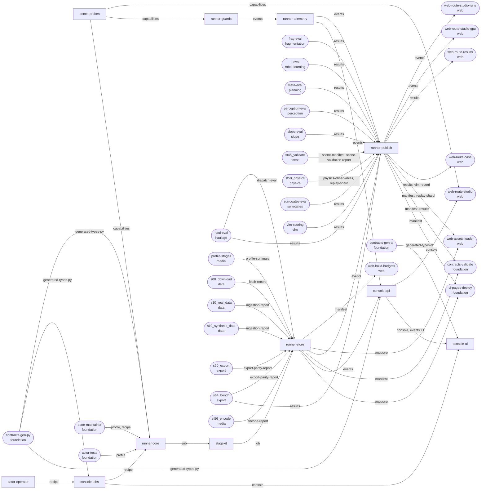

Rounded boxes are modules of other areas that produce or consume a contract of this area.

| Module | Spec | Env | GPU | Kind | Inputs | Outputs |
|---|---|---|---|---|---|---|
| `actor-operator` | 003 | external | no | actor | - | `recipe` |
| `runner-core` | 002 | root | no | runner | `capabilities`, `generated-types-py`, `profile`, `recipe` | `job` |
| `runner-guards` | 002 | root | no | runner | `capabilities` | `events` |
| `runner-telemetry` | 002 | root | no | runner | `events` | `events` |
| `runner-store` | 002 | root | no | runner | `dispatch-eval`, `encode-report`, `export-parity-report`, `fetch-record`, `ingestion-report`, `job`, `profile-summary` | `events`, `manifest` |
| `runner-publish` | 002 | root | no | runner | `events`, `physics-observables`, `replay-shard`, `results`, `scene-manifest`, `scene-validation-report` | `events`, `manifest`, `replay-shard`, `results`, `vlm-record` |
| `stagekit` | 002 | root | no | lib | `job` | `job` |
| `bench-probes` | 002 | studio | yes | probe | - | `capabilities` |
| `console-api` | 003 | root | no | api | `events`, `generated-types-py` | `console`, `events`, `openapi` |
| `console-jobs` | 003 | root | no | api | `generated-types-py`, `recipe` | `console`, `recipe` |
| `console-ui` | 003 | web | no | ui | `console`, `events`, `generated-types-ts`, `openapi` | - |

### Scene pipeline st10-st45 (spec 004)

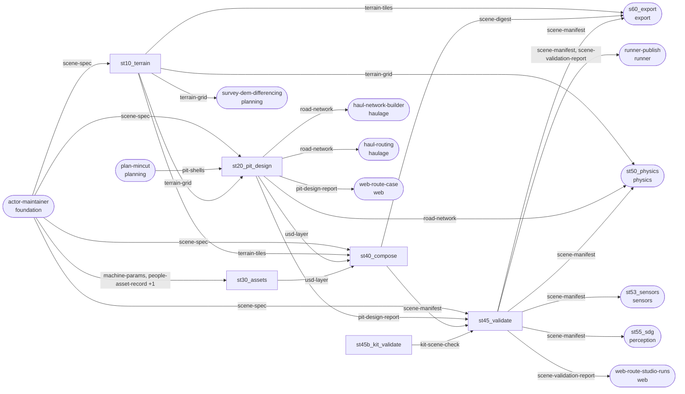

Rounded boxes are modules of other areas that produce or consume a contract of this area.

| Module | Spec | Env | GPU | Kind | Inputs | Outputs |
|---|---|---|---|---|---|---|
| `st10_terrain` | 004 | studio | no | stage | `scene-spec` | `terrain-grid`, `terrain-tiles` |
| `st20_pit_design` | 004 | studio | no | stage | `pit-shells`, `scene-spec`, `terrain-grid` | `pit-design-report`, `road-network`, `usd-layer` |
| `st30_assets` | 004 | studio | no | stage | `machine-params`, `people-asset-record`, `scene-spec` | `usd-layer` |
| `st40_compose` | 004 | studio | no | stage | `scene-spec`, `terrain-tiles`, `usd-layer` | `scene-digest`, `scene-manifest` |
| `st45_validate` | 004 | studio | no | stage | `kit-scene-check`, `pit-design-report`, `scene-manifest`, `scene-spec` | `scene-manifest`, `scene-validation-report` |
| `st45b_kit_validate` | 004 | studio/isaac | no | stage | - | `kit-scene-check` |

### Physics solvers and calibration (specs 005, 011)

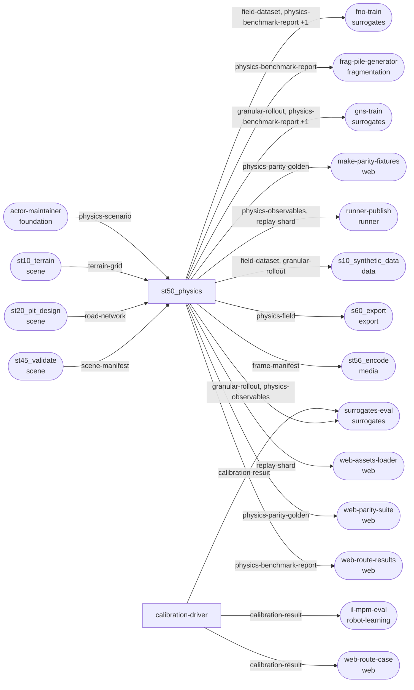

Rounded boxes are modules of other areas that produce or consume a contract of this area.

| Module | Spec | Env | GPU | Kind | Inputs | Outputs |
|---|---|---|---|---|---|---|
| `st50_physics` | 005 | studio | yes | solver | `physics-scenario`, `road-network`, `scene-manifest`, `terrain-grid` | `field-dataset`, `frame-manifest`, `granular-rollout`, `physics-benchmark-report`, `physics-field`, `physics-observables`, `physics-parity-golden`, `replay-shard` |
| `calibration-driver` | 011 | studio | yes | solver | - | `calibration-result` |

### Media and telemetry (spec 006)

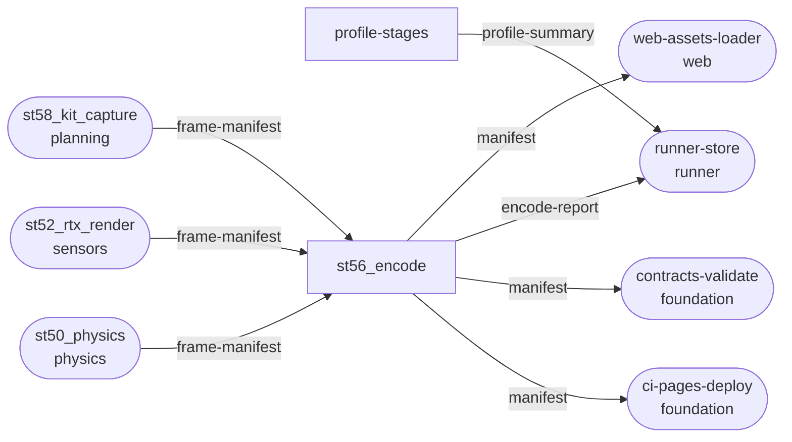

Rounded boxes are modules of other areas that produce or consume a contract of this area.

| Module | Spec | Env | GPU | Kind | Inputs | Outputs |
|---|---|---|---|---|---|---|
| `st56_encode` | 006 | studio | yes | stage | `frame-manifest` | `encode-report`, `manifest` |
| `profile-stages` | 006 | studio | yes | tool | - | `profile-summary` |

### Data pipeline s00-s20 (spec 008, domains of 007, 010, 013, 017)

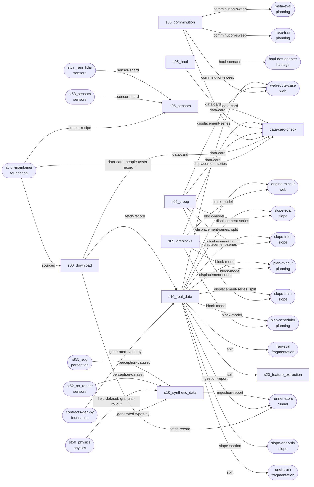

Rounded boxes are modules of other areas that produce or consume a contract of this area.

| Module | Spec | Env | GPU | Kind | Inputs | Outputs |
|---|---|---|---|---|---|---|
| `s00_download` | 008 | pipeline | no | ingestion | `sources` | `data-card`, `fetch-record` |
| `s05_haul` | 007 | pipeline | no | ingestion | - | `data-card`, `haul-scenario` |
| `s05_creep` | 010 | pipeline | no | ingestion | - | `data-card`, `displacement-series` |
| `s05_sensors` | 013 | pipeline | no | ingestion | `sensor-recipe`, `sensor-shard` | `data-card` |
| `s05_comminution` | 017 | pipeline | no | ingestion | - | `comminution-sweep`, `data-card` |
| `s05_oreblocks` | 017 | pipeline | no | ingestion | - | `block-model`, `data-card` |
| `s10_real_data` | 008 | pipeline | no | ingestion | `fetch-record`, `generated-types-py` | `block-model`, `displacement-series`, `ingestion-report`, `slope-section`, `split` |
| `s10_synthetic_data` | 008 | pipeline | no | ingestion | `field-dataset`, `generated-types-py`, `granular-rollout`, `perception-dataset` | `ingestion-report` |
| `s20_feature_extraction` | 008 | pipeline | no | ingestion | `split` | - |
| `data-card-check` | 008 | root | no | tool | `data-card`, `people-asset-record` | - |

### Haulage and dispatch (spec 007)

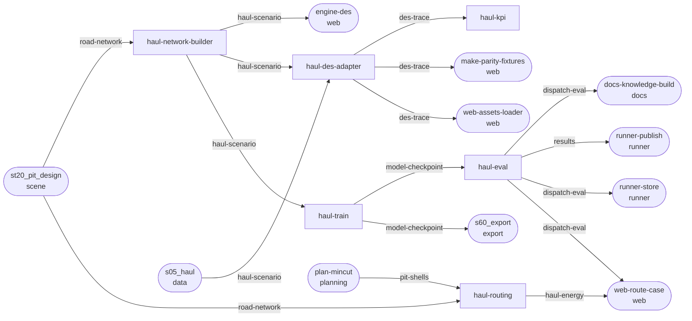

Rounded boxes are modules of other areas that produce or consume a contract of this area.

| Module | Spec | Env | GPU | Kind | Inputs | Outputs |
|---|---|---|---|---|---|---|
| `haul-network-builder` | 007 | pipeline | no | ingestion | `road-network` | `haul-scenario` |
| `haul-des-adapter` | 007 | pipeline | no | solver | `haul-scenario` | `des-trace` |
| `haul-kpi` | 007 | pipeline | no | solver | `des-trace` | - |
| `haul-routing` | 007 | pipeline | no | solver | `pit-shells`, `road-network` | `haul-energy` |
| `haul-train` | 007 | pipeline | yes | train | `haul-scenario` | `model-checkpoint` |
| `haul-eval` | 007 | pipeline | no | eval | `model-checkpoint` | `dispatch-eval`, `results` |

### Perception (spec 009)

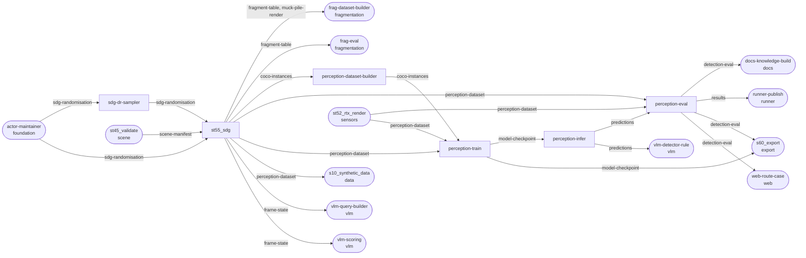

Rounded boxes are modules of other areas that produce or consume a contract of this area.

| Module | Spec | Env | GPU | Kind | Inputs | Outputs |
|---|---|---|---|---|---|---|
| `st55_sdg` | 009 | studio/isaac | yes | sdg | `scene-manifest`, `sdg-randomisation` | `coco-instances`, `fragment-table`, `frame-state`, `muck-pile-render`, `perception-dataset` |
| `sdg-dr-sampler` | 009 | studio | no | sdg | `sdg-randomisation` | `sdg-randomisation` |
| `perception-dataset-builder` | 009 | pipeline | no | ingestion | `coco-instances` | `coco-instances` |
| `perception-train` | 009 | pipeline | yes | train | `coco-instances`, `perception-dataset` | `model-checkpoint` |
| `perception-infer` | 009 | pipeline | yes | infer | `model-checkpoint` | `predictions` |
| `perception-eval` | 009 | pipeline | no | eval | `perception-dataset`, `predictions` | `detection-eval`, `results` |

### Slope stability and forecasting (spec 010)

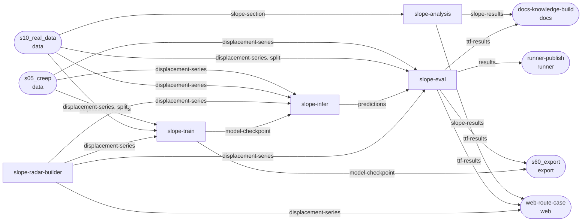

Rounded boxes are modules of other areas that produce or consume a contract of this area.

| Module | Spec | Env | GPU | Kind | Inputs | Outputs |
|---|---|---|---|---|---|---|
| `slope-analysis` | 010 | pipeline | no | solver | `slope-section` | `slope-results` |
| `slope-radar-builder` | 010 | pipeline | no | ingestion | - | `displacement-series` |
| `slope-train` | 010 | pipeline | yes | train | `displacement-series`, `split` | `model-checkpoint` |
| `slope-infer` | 010 | pipeline | no | infer | `displacement-series`, `model-checkpoint` | `predictions` |
| `slope-eval` | 010 | pipeline | no | eval | `displacement-series`, `predictions`, `split` | `results`, `ttf-results` |

### Surrogates: GNS, FNO (spec 011)

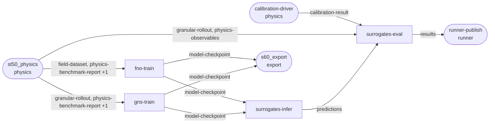

Rounded boxes are modules of other areas that produce or consume a contract of this area.

| Module | Spec | Env | GPU | Kind | Inputs | Outputs |
|---|---|---|---|---|---|---|
| `gns-train` | 011 | pipeline | yes | train | `granular-rollout`, `physics-benchmark-report`, `physics-observables` | `model-checkpoint` |
| `fno-train` | 011 | pipeline | yes | train | `field-dataset`, `physics-benchmark-report`, `physics-field` | `model-checkpoint` |
| `surrogates-infer` | 011 | pipeline | no | infer | `model-checkpoint` | `predictions` |
| `surrogates-eval` | 011 | pipeline | no | eval | `calibration-result`, `granular-rollout`, `physics-observables`, `predictions` | `results` |

### Fragmentation (spec 012)

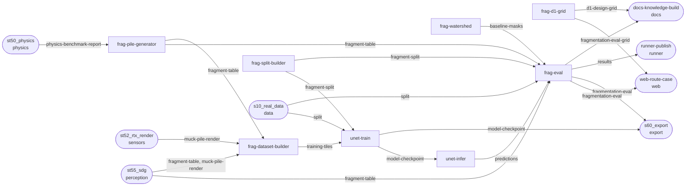

Rounded boxes are modules of other areas that produce or consume a contract of this area.

| Module | Spec | Env | GPU | Kind | Inputs | Outputs |
|---|---|---|---|---|---|---|
| `frag-pile-generator` | 012 | studio | yes | solver | `physics-benchmark-report` | `fragment-table` |
| `frag-dataset-builder` | 012 | pipeline | no | ingestion | `fragment-table`, `muck-pile-render` | `training-tiles` |
| `frag-split-builder` | 012 | pipeline | no | ingestion | - | `fragment-split` |
| `unet-train` | 012 | pipeline | yes | train | `fragment-split`, `split`, `training-tiles` | `model-checkpoint` |
| `unet-infer` | 012 | pipeline | no | infer | `model-checkpoint` | `predictions` |
| `frag-watershed` | 012 | pipeline | no | solver | - | `baseline-masks` |
| `frag-eval` | 012 | pipeline | no | eval | `baseline-masks`, `fragment-split`, `fragment-table`, `predictions`, `split` | `fragmentation-eval`, `results` |
| `frag-d1-grid` | 012 | pipeline | no | solver | - | `d1-design-grid` |

### Sensors, ovrtx lane (spec 013)

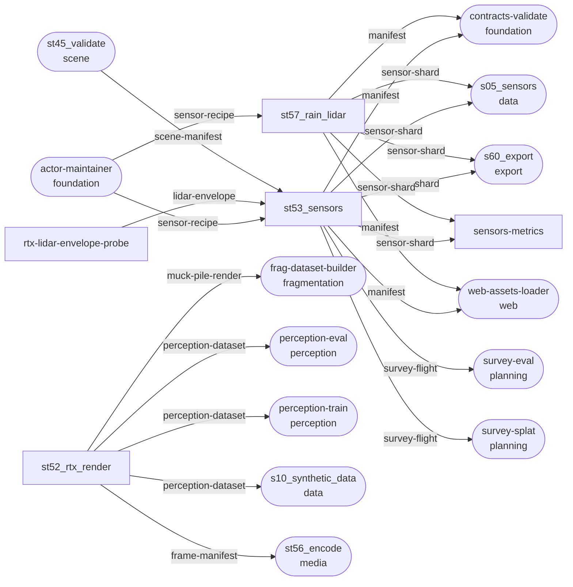

Rounded boxes are modules of other areas that produce or consume a contract of this area.

| Module | Spec | Env | GPU | Kind | Inputs | Outputs |
|---|---|---|---|---|---|---|
| `st52_rtx_render` | 013 | studio/rtx | yes | stage | - | `frame-manifest`, `muck-pile-render`, `perception-dataset` |
| `st53_sensors` | 013 | studio/rtx | yes | stage | `lidar-envelope`, `scene-manifest`, `sensor-recipe` | `manifest`, `sensor-shard`, `survey-flight` |
| `st57_rain_lidar` | 013 | studio/isaac | yes | stage | `sensor-recipe` | `manifest`, `sensor-shard` |
| `rtx-lidar-envelope-probe` | 013 | studio/rtx | yes | probe | - | `lidar-envelope` |
| `sensors-metrics` | 013 | pipeline | no | eval | `sensor-shard` | - |

### Robot learning (spec 014)

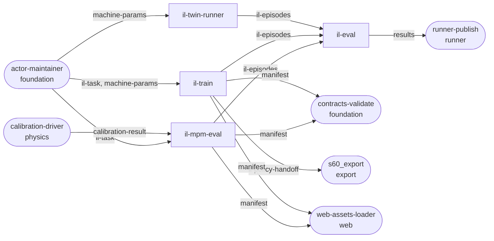

Rounded boxes are modules of other areas that produce or consume a contract of this area.

| Module | Spec | Env | GPU | Kind | Inputs | Outputs |
|---|---|---|---|---|---|---|
| `il-train` | 014 | studio/isaaclab | yes | train | `il-task`, `machine-params` | `il-episodes`, `il-policy-handoff`, `manifest` |
| `il-mpm-eval` | 014 | studio/isaaclab | yes | eval | `calibration-result`, `il-task` | `il-episodes`, `manifest` |
| `il-twin-runner` | 014 | pipeline | no | solver | `machine-params` | `il-episodes` |
| `il-eval` | 014 | pipeline | no | eval | `il-episodes` | `results` |

### Vision-language models (spec 015)

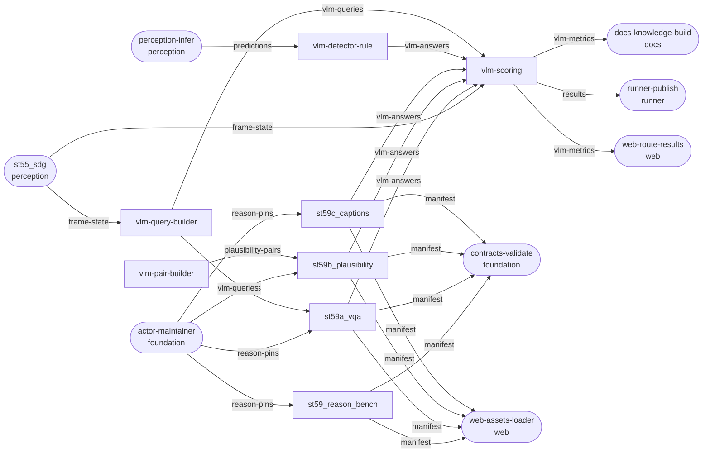

Rounded boxes are modules of other areas that produce or consume a contract of this area.

| Module | Spec | Env | GPU | Kind | Inputs | Outputs |
|---|---|---|---|---|---|---|
| `vlm-query-builder` | 015 | root | no | ingestion | `frame-state` | `vlm-queries` |
| `vlm-pair-builder` | 015 | root | no | ingestion | - | `plausibility-pairs` |
| `st59a_vqa` | 015 | studio | yes | stage | `reason-pins`, `vlm-queries` | `manifest`, `vlm-answers` |
| `st59b_plausibility` | 015 | studio | yes | stage | `plausibility-pairs`, `reason-pins` | `manifest`, `vlm-answers` |
| `st59c_captions` | 015 | studio | yes | stage | `reason-pins` | `manifest`, `vlm-answers` |
| `st59_reason_bench` | 015 | studio | yes | stage | `reason-pins` | `manifest` |
| `vlm-scoring` | 015 | root | no | eval | `frame-state`, `vlm-answers`, `vlm-queries` | `results`, `vlm-metrics` |
| `vlm-detector-rule` | 015 | root | no | solver | `predictions` | `vlm-answers` |

### Export and acceleration (spec 016)

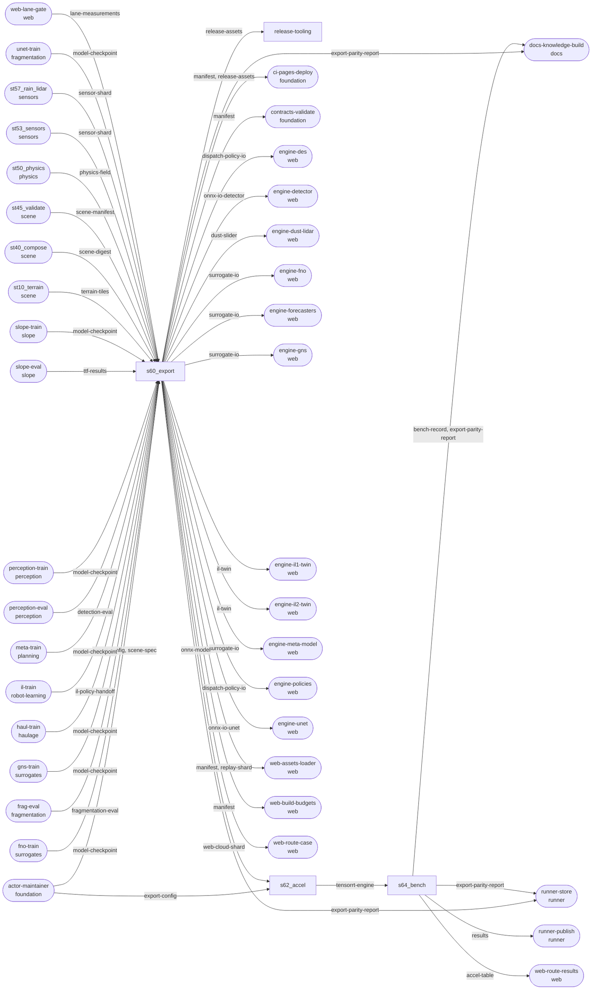

Rounded boxes are modules of other areas that produce or consume a contract of this area.

| Module | Spec | Env | GPU | Kind | Inputs | Outputs |
|---|---|---|---|---|---|---|
| `s60_export` | 016 | pipeline | no | export | `detection-eval`, `export-config`, `fragmentation-eval`, `il-policy-handoff`, `lane-measurements`, `model-checkpoint`, `physics-field`, `scene-digest`, `scene-manifest`, `scene-spec`, `sensor-shard`, `terrain-tiles`, `ttf-results` | `dispatch-policy-io`, `dust-slider`, `export-parity-report`, `il-twin`, `manifest`, `onnx-io-detector`, `onnx-io-unet`, `onnx-model`, `release-assets`, `replay-shard`, `surrogate-io`, `web-cloud-shard` |
| `s62_accel` | 016 | pipeline/accel | yes | export | `export-config`, `onnx-model` | `tensorrt-engine` |
| `s64_bench` | 016 | pipeline/accel | yes | eval | `tensorrt-engine` | `accel-table`, `bench-record`, `export-parity-report`, `results` |
| `release-tooling` | 016 | root | no | release | `release-assets` | - |

### Planning and survey (spec 017)

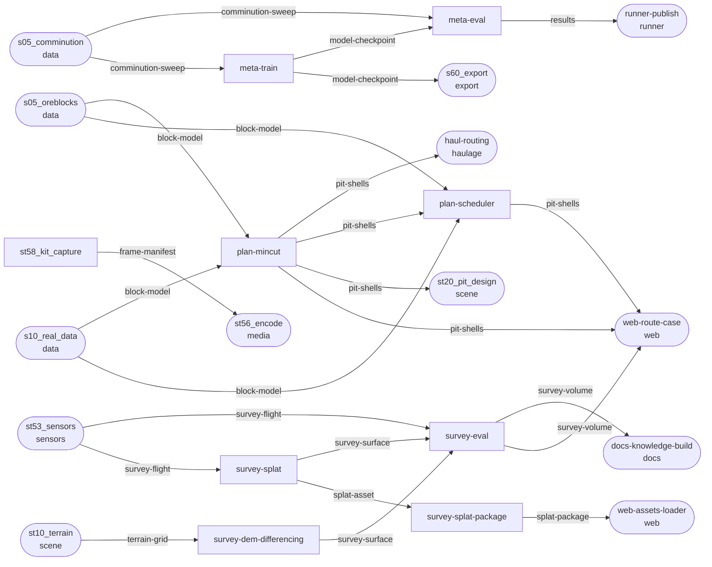

Rounded boxes are modules of other areas that produce or consume a contract of this area.

| Module | Spec | Env | GPU | Kind | Inputs | Outputs |
|---|---|---|---|---|---|---|
| `meta-train` | 017 | pipeline | no | train | `comminution-sweep` | `model-checkpoint` |
| `meta-eval` | 017 | pipeline | no | eval | `comminution-sweep`, `model-checkpoint` | `results` |
| `plan-mincut` | 017 | pipeline | no | solver | `block-model` | `pit-shells` |
| `plan-scheduler` | 017 | pipeline | no | solver | `block-model`, `pit-shells` | `pit-shells` |
| `survey-dem-differencing` | 017 | pipeline | no | solver | `terrain-grid` | `survey-surface` |
| `survey-splat` | 017 | studio | yes | stage | `survey-flight` | `splat-asset`, `survey-surface` |
| `survey-splat-package` | 017 | pipeline | no | export | `splat-asset` | `splat-package` |
| `st58_kit_capture` | 017 | studio/isaac | yes | stage | - | `frame-manifest` |
| `survey-eval` | 017 | pipeline | no | eval | `survey-flight`, `survey-surface` | `survey-volume` |

### Web app: routes, engines, build (specs 018, 019, 020)

```mermaid
flowchart LR
  engine_blasting["engine-blasting"]
  engine_comminution["engine-comminution"]
  engine_des["engine-des"]
  engine_detector["engine-detector"]
  engine_dust_lidar["engine-dust-lidar"]
  engine_dust_particles["engine-dust-particles"]
  engine_fno["engine-fno"]
  engine_forecasters["engine-forecasters"]
  engine_geotech["engine-geotech"]
  engine_gns["engine-gns"]
  engine_granular["engine-granular"]
  engine_haulage["engine-haulage"]
  engine_il1_twin["engine-il1-twin"]
  engine_il2_twin["engine-il2-twin"]
  engine_lp["engine-lp"]
  engine_meta_model["engine-meta-model"]
  engine_mincut["engine-mincut"]
  engine_plume["engine-plume"]
  engine_policies["engine-policies"]
  engine_routing["engine-routing"]
  engine_swe["engine-swe"]
  engine_traffic["engine-traffic"]
  engine_unet["engine-unet"]
  engine_volume["engine-volume"]
  engine_watershed["engine-watershed"]
  make_parity_fixtures["make-parity-fixtures"]
  web_assets_loader["web-assets-loader"]
  web_build_budgets["web-build-budgets"]
  web_build_studio_index["web-build-studio-index"]
  web_engine_host["web-engine-host"]
  web_lane_gate["web-lane-gate"]
  web_media["web-media"]
  web_parity_suite["web-parity-suite"]
  web_route_case["web-route-case"]
  web_route_cases["web-route-cases"]
  web_route_explore["web-route-explore"]
  web_route_knowledge["web-route-knowledge"]
  web_route_methods["web-route-methods"]
  web_route_results["web-route-results"]
  web_route_studio["web-route-studio"]
  web_route_studio_gpu["web-route-studio-gpu"]
  web_route_studio_runs["web-route-studio-runs"]
  web_route_studio_tool["web-route-studio-tool"]
  web_route_theory["web-route-theory"]
  web_shell["web-shell"]
  web_sim_clock["web-sim-clock"]
  web_tier_probe["web-tier-probe"]
  actor_maintainer(["actor-maintainer<br/>foundation"])
  bench_probes(["bench-probes<br/>runner"])
  calibration_driver(["calibration-driver<br/>physics"])
  ci_lane_check(["ci-lane-check<br/>foundation"])
  console_api(["console-api<br/>runner"])
  contracts_gen_ts(["contracts-gen-ts<br/>foundation"])
  contracts_validate(["contracts-validate<br/>foundation"])
  docs_knowledge_build(["docs-knowledge-build<br/>docs"])
  frag_d1_grid(["frag-d1-grid<br/>fragmentation"])
  frag_eval(["frag-eval<br/>fragmentation"])
  haul_des_adapter(["haul-des-adapter<br/>haulage"])
  haul_eval(["haul-eval<br/>haulage"])
  haul_network_builder(["haul-network-builder<br/>haulage"])
  haul_routing(["haul-routing<br/>haulage"])
  il_mpm_eval(["il-mpm-eval<br/>robot-learning"])
  il_train(["il-train<br/>robot-learning"])
  perception_eval(["perception-eval<br/>perception"])
  plan_mincut(["plan-mincut<br/>planning"])
  plan_scheduler(["plan-scheduler<br/>planning"])
  runner_publish(["runner-publish<br/>runner"])
  runner_store(["runner-store<br/>runner"])
  s05_comminution(["s05_comminution<br/>data"])
  s05_creep(["s05_creep<br/>data"])
  s05_oreblocks(["s05_oreblocks<br/>data"])
  s10_real_data(["s10_real_data<br/>data"])
  s60_export(["s60_export<br/>export"])
  s64_bench(["s64_bench<br/>export"])
  slope_analysis(["slope-analysis<br/>slope"])
  slope_eval(["slope-eval<br/>slope"])
  slope_radar_builder(["slope-radar-builder<br/>slope"])
  st20_pit_design(["st20_pit_design<br/>scene"])
  st45_validate(["st45_validate<br/>scene"])
  st50_physics(["st50_physics<br/>physics"])
  st53_sensors(["st53_sensors<br/>sensors"])
  st56_encode(["st56_encode<br/>media"])
  st57_rain_lidar(["st57_rain_lidar<br/>sensors"])
  st59_reason_bench(["st59_reason_bench<br/>vlm"])
  st59a_vqa(["st59a_vqa<br/>vlm"])
  st59b_plausibility(["st59b_plausibility<br/>vlm"])
  st59c_captions(["st59c_captions<br/>vlm"])
  survey_eval(["survey-eval<br/>planning"])
  survey_splat_package(["survey-splat-package<br/>planning"])
  vlm_scoring(["vlm-scoring<br/>vlm"])
  actor_maintainer -->|"engine-io"| make_parity_fixtures
  actor_maintainer -->|"toolmap"| web_build_studio_index
  actor_maintainer -->|"cases"| web_route_case
  actor_maintainer -->|"cases"| web_route_cases
  actor_maintainer -->|"cases"| web_route_explore
  actor_maintainer -->|"methods"| web_route_methods
  actor_maintainer -->|"methods"| web_route_results
  actor_maintainer -->|"tools"| web_route_studio
  actor_maintainer -->|"cases"| web_route_studio_tool
  actor_maintainer -->|"figures"| web_route_theory
  bench_probes -->|"capabilities"| web_route_studio
  calibration_driver -->|"calibration-result"| web_route_case
  console_api -->|"console"| web_route_studio
  contracts_gen_ts -->|"generated-types-ts"| web_assets_loader
  contracts_gen_ts -->|"generated-types-ts"| web_engine_host
  docs_knowledge_build -->|"knowledge-bundle"| web_route_knowledge
  docs_knowledge_build -->|"knowledge-bundle"| web_route_theory
  engine_blasting -->|"engine-io-blasting"| web_engine_host
  engine_comminution -->|"engine-io-comminution"| web_engine_host
  engine_des -->|"engine-io-des"| web_engine_host
  engine_detector -->|"engine-io-detector"| web_engine_host
  engine_dust_lidar -->|"engine-io-dust-lidar"| web_engine_host
  engine_dust_particles -->|"engine-io-dust-particles"| web_engine_host
  engine_fno -->|"engine-io-fno"| web_engine_host
  engine_forecasters -->|"engine-io-forecasters"| web_engine_host
  engine_geotech -->|"engine-io-geotech"| web_engine_host
  engine_gns -->|"engine-io-gns"| web_engine_host
  engine_granular -->|"engine-io-granular"| web_engine_host
  engine_haulage -->|"engine-io-haulage"| web_engine_host
  engine_il1_twin -->|"engine-io-il1-twin"| web_engine_host
  engine_il2_twin -->|"engine-io-il2-twin"| web_engine_host
  engine_lp -->|"engine-io-lp"| web_engine_host
  engine_meta_model -->|"engine-io-meta-model"| web_engine_host
  engine_mincut -->|"engine-io-mincut"| web_engine_host
  engine_plume -->|"engine-io-plume"| web_engine_host
  engine_policies -->|"engine-io-policies"| web_engine_host
  engine_routing -->|"engine-io-routing"| web_engine_host
  engine_swe -->|"engine-io-swe"| web_engine_host
  engine_traffic -->|"engine-io-traffic"| web_engine_host
  engine_unet -->|"engine-io-unet"| web_engine_host
  engine_volume -->|"engine-io-volume"| web_engine_host
  engine_watershed -->|"engine-io-watershed"| web_engine_host
  frag_d1_grid -->|"d1-design-grid"| web_route_case
  frag_eval -->|"fragmentation-eval"| web_route_case
  haul_des_adapter -->|"des-trace"| make_parity_fixtures
  haul_des_adapter -->|"des-trace"| web_assets_loader
  haul_eval -->|"dispatch-eval"| web_route_case
  haul_network_builder -->|"haul-scenario"| engine_des
  haul_routing -->|"haul-energy"| web_route_case
  il_mpm_eval -->|"manifest"| web_assets_loader
  il_train -->|"manifest"| web_assets_loader
  make_parity_fixtures -->|"parity-fixture"| web_parity_suite
  perception_eval -->|"detection-eval"| web_route_case
  plan_mincut -->|"pit-shells"| web_route_case
  plan_scheduler -->|"pit-shells"| web_route_case
  runner_publish -->|"manifest, replay-shard"| web_assets_loader
  runner_publish -->|"results, vlm-record"| web_route_case
  runner_publish -->|"results"| web_route_results
  runner_publish -->|"events"| web_route_studio_gpu
  runner_publish -->|"events"| web_route_studio_runs
  runner_store -->|"manifest"| web_assets_loader
  runner_store -->|"manifest"| web_build_budgets
  s05_comminution -->|"comminution-sweep"| web_route_case
  s05_creep -->|"displacement-series"| web_route_case
  s05_oreblocks -->|"block-model"| engine_mincut
  s10_real_data -->|"block-model"| engine_mincut
  s10_real_data -->|"displacement-series"| web_route_case
  s60_export -->|"dispatch-policy-io"| engine_des
  s60_export -->|"onnx-io-detector"| engine_detector
  s60_export -->|"dust-slider"| engine_dust_lidar
  s60_export -->|"surrogate-io"| engine_fno
  s60_export -->|"surrogate-io"| engine_forecasters
  s60_export -->|"surrogate-io"| engine_gns
  s60_export -->|"il-twin"| engine_il1_twin
  s60_export -->|"il-twin"| engine_il2_twin
  s60_export -->|"surrogate-io"| engine_meta_model
  s60_export -->|"dispatch-policy-io"| engine_policies
  s60_export -->|"onnx-io-unet"| engine_unet
  s60_export -->|"manifest, replay-shard"| web_assets_loader
  s60_export -->|"manifest"| web_build_budgets
  s60_export -->|"web-cloud-shard"| web_route_case
  s64_bench -->|"accel-table"| web_route_results
  slope_analysis -->|"slope-results"| web_route_case
  slope_eval -->|"ttf-results"| web_route_case
  slope_radar_builder -->|"displacement-series"| web_route_case
  st20_pit_design -->|"pit-design-report"| web_route_case
  st45_validate -->|"scene-validation-report"| web_route_studio_runs
  st50_physics -->|"physics-parity-golden"| make_parity_fixtures
  st50_physics -->|"replay-shard"| web_assets_loader
  st50_physics -->|"physics-parity-golden"| web_parity_suite
  st50_physics -->|"physics-benchmark-report"| web_route_results
  st53_sensors -->|"manifest"| web_assets_loader
  st56_encode -->|"manifest"| web_assets_loader
  st57_rain_lidar -->|"manifest"| web_assets_loader
  st59_reason_bench -->|"manifest"| web_assets_loader
  st59a_vqa -->|"manifest"| web_assets_loader
  st59b_plausibility -->|"manifest"| web_assets_loader
  st59c_captions -->|"manifest"| web_assets_loader
  survey_eval -->|"survey-volume"| web_route_case
  survey_splat_package -->|"splat-package"| web_assets_loader
  vlm_scoring -->|"vlm-metrics"| web_route_results
  web_assets_loader -->|"manifest"| web_media
  web_assets_loader -->|"manifest, replay-shard"| web_route_case
  web_assets_loader -->|"manifest"| web_route_explore
  web_assets_loader -->|"manifest"| web_route_studio_gpu
  web_assets_loader -->|"manifest"| web_route_studio_runs
  web_assets_loader -->|"manifest"| web_route_studio_tool
  web_build_studio_index -->|"studio-index"| contracts_validate
  web_build_studio_index -->|"studio-index"| web_route_studio
  web_build_studio_index -->|"studio-index"| web_route_studio_gpu
  web_build_studio_index -->|"studio-index"| web_route_studio_runs
  web_build_studio_index -->|"studio-index"| web_route_studio_tool
  web_engine_host -->|"engine-io"| web_route_case
  web_lane_gate -->|"lane-measurements"| ci_lane_check
  web_lane_gate -->|"lane-measurements"| s60_export
  web_parity_suite -->|"parity-report"| web_engine_host
  web_parity_suite -->|"parity-report"| web_route_results
```

Rounded boxes are modules of other areas that produce or consume a contract of this area.

| Module | Spec | Env | GPU | Kind | Inputs | Outputs |
|---|---|---|---|---|---|---|
| `web-shell` | 018 | web | no | lib | - | - |
| `web-sim-clock` | 018 | web | no | lib | - | - |
| `web-tier-probe` | 018 | web | no | lib | - | - |
| `web-assets-loader` | 018 | web | no | lib | `des-trace`, `generated-types-ts`, `manifest`, `replay-shard`, `splat-package` | `manifest`, `replay-shard` |
| `web-engine-host` | 018 | web | no | lib | `engine-io-blasting`, `engine-io-comminution`, `engine-io-des`, `engine-io-detector`, `engine-io-dust-lidar`, `engine-io-dust-particles`, `engine-io-fno`, `engine-io-forecasters`, `engine-io-geotech`, `engine-io-gns`, `engine-io-granular`, `engine-io-haulage`, `engine-io-il1-twin`, `engine-io-il2-twin`, `engine-io-lp`, `engine-io-meta-model`, `engine-io-mincut`, `engine-io-plume`, `engine-io-policies`, `engine-io-routing`, `engine-io-swe`, `engine-io-traffic`, `engine-io-unet`, `engine-io-volume`, `engine-io-watershed`, `generated-types-ts`, `parity-report` | `engine-io` |
| `web-media` | 018 | web | no | lib | `manifest` | - |
| `web-route-explore` | 018 | web | no | route | `cases`, `manifest` | - |
| `web-route-cases` | 018 | web | no | route | `cases` | - |
| `web-route-case` | 018 | web | no | route | `calibration-result`, `cases`, `comminution-sweep`, `d1-design-grid`, `detection-eval`, `dispatch-eval`, `displacement-series`, `engine-io`, `fragmentation-eval`, `haul-energy`, `manifest`, `pit-design-report`, `pit-shells`, `replay-shard`, `results`, `slope-results`, `survey-volume`, `ttf-results`, `vlm-record`, `web-cloud-shard` | - |
| `web-route-studio` | 019 | web | no | route | `capabilities`, `console`, `studio-index`, `tools` | - |
| `web-route-studio-tool` | 019 | web | no | route | `cases`, `manifest`, `studio-index` | - |
| `web-route-studio-runs` | 019 | web | no | route | `events`, `manifest`, `scene-validation-report`, `studio-index` | - |
| `web-route-studio-gpu` | 019 | web | no | route | `events`, `manifest`, `studio-index` | - |
| `web-build-studio-index` | 019 | web | no | tool | `toolmap` | `studio-index` |
| `web-route-theory` | 020 | web | no | route | `figures`, `knowledge-bundle` | - |
| `web-route-methods` | 020 | web | no | route | `methods` | - |
| `web-route-results` | 020 | web | no | route | `accel-table`, `methods`, `parity-report`, `physics-benchmark-report`, `results`, `vlm-metrics` | - |
| `web-route-knowledge` | 020 | web | no | route | `knowledge-bundle` | - |
| `web-build-budgets` | 020 | web | no | tool | `manifest` | - |
| `web-parity-suite` | 018 | web | no | tool | `parity-fixture`, `physics-parity-golden` | `parity-report` |
| `web-lane-gate` | 018 | web | no | tool | - | `lane-measurements` |
| `make-parity-fixtures` | 018 | pipeline | no | tool | `des-trace`, `engine-io`, `physics-parity-golden` | `parity-fixture` |
| `engine-des` | 007 | web | no | engine | `dispatch-policy-io`, `haul-scenario` | `engine-io-des` |
| `engine-policies` | 007 | web | no | engine | `dispatch-policy-io` | `engine-io-policies` |
| `engine-haulage` | 007 | web | no | engine | - | `engine-io-haulage` |
| `engine-lp` | 007 | web | no | engine | - | `engine-io-lp` |
| `engine-routing` | 007 | web | no | engine | - | `engine-io-routing` |
| `engine-il1-twin` | 014 | web | no | engine | `il-twin` | `engine-io-il1-twin` |
| `engine-il2-twin` | 014 | web | no | engine | `il-twin` | `engine-io-il2-twin` |
| `engine-granular` | 018 | web | no | engine | - | `engine-io-granular` |
| `engine-gns` | 018 | web | no | engine | `surrogate-io` | `engine-io-gns` |
| `engine-traffic` | 018 | web | no | engine | - | `engine-io-traffic` |
| `engine-dust-lidar` | 013 | web | no | engine | `dust-slider` | `engine-io-dust-lidar` |
| `engine-detector` | 018 | web | no | engine | `onnx-io-detector` | `engine-io-detector` |
| `engine-geotech` | 018 | web | no | engine | - | `engine-io-geotech` |
| `engine-forecasters` | 018 | web | no | engine | `surrogate-io` | `engine-io-forecasters` |
| `engine-swe` | 018 | web | no | engine | - | `engine-io-swe` |
| `engine-fno` | 018 | web | no | engine | `surrogate-io` | `engine-io-fno` |
| `engine-plume` | 018 | web | no | engine | - | `engine-io-plume` |
| `engine-dust-particles` | 018 | web | no | engine | - | `engine-io-dust-particles` |
| `engine-blasting` | 018 | web | no | engine | - | `engine-io-blasting` |
| `engine-watershed` | 018 | web | no | engine | - | `engine-io-watershed` |
| `engine-unet` | 018 | web | no | engine | `onnx-io-unet` | `engine-io-unet` |
| `engine-comminution` | 018 | web | no | engine | - | `engine-io-comminution` |
| `engine-meta-model` | 018 | web | no | engine | `surrogate-io` | `engine-io-meta-model` |
| `engine-mincut` | 018 | web | no | engine | `block-model` | `engine-io-mincut` |
| `engine-volume` | 018 | web | no | engine | - | `engine-io-volume` |

### Docs and knowledge build

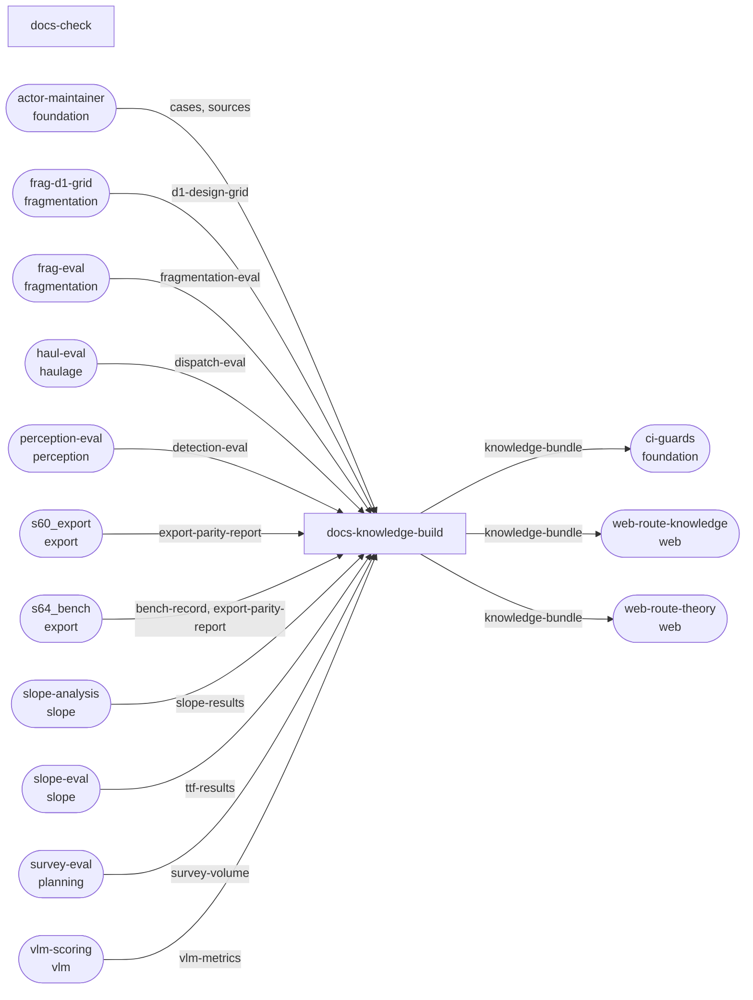

Rounded boxes are modules of other areas that produce or consume a contract of this area.

| Module | Spec | Env | GPU | Kind | Inputs | Outputs |
|---|---|---|---|---|---|---|
| `docs-knowledge-build` | 020 | root | no | docs | `bench-record`, `cases`, `d1-design-grid`, `detection-eval`, `dispatch-eval`, `export-parity-report`, `fragmentation-eval`, `slope-results`, `sources`, `survey-volume`, `ttf-results`, `vlm-metrics` | `knowledge-bundle` |
| `docs-check` | 000 | root | no | docs | - | - |

## 5. Checks

The checks below were run over `modules.yaml` when this map was written. They are the checks of the CI task T-000-092 (schema, acyclicity, every edge naming an existing module and contract, every DC row an edge or an output).

### 5.1 Acyclicity

Kahn's algorithm removes all 147 modules: **no cycle** (392 edges, 0 strongly connected components of more than one module).

### 5.2 Data-contract rows

All 113 active DC rows of the feature specs appear as at least one edge. The three retired rows (DC-008-01, DC-013-06, DC-019-01) are not mapped; each is superseded by a mapped row (DC-001-04, DC-010-02, DC-002-03 with DC-001-01).

### 5.3 Edges whose contract has no schema at all

36 of 392 edges. None of them is a DC row: they are boundaries that the specs cross without defining a contract. Each needs either a promoted schema (class `undefined`) or a recorded decision that the format and its validator are the contract (class `binary-format`).

| Edge | From | To | Contract | Class | What | Evidence |
|---|---|---|---|---|---|---|
| E-GAP-01 | `frag-dataset-builder` | `unet-train` | `training-tiles` | undefined | synthetic 512 x 512 training tiles with masks | FR-012-17 and FR-012-22 name the training tiles; DC-012-04 is the render index that feeds the builder, not its output |
| E-GAP-02 | `frag-watershed` | `frag-eval` | `baseline-masks` | undefined | watershed plus Swebrec baseline masks and PSDs per tile | FR-012-32 compares against it; no schema defines the baseline output |
| E-GAP-03 | `st20_pit_design` | `st40_compose` | `usd-layer` | binary-format | OpenUSD design layers composed into the scene | OpenUSD layers; the contract is the USD format plus the unit, axis and SHA-256 rules of FR-004-32; no JSON Schema |
| E-GAP-04 | `st30_assets` | `st40_compose` | `usd-layer` | binary-format | OpenUSD asset layers composed into the scene | same |
| E-GAP-05 | `s60_export` | `s62_accel` | `onnx-model` | binary-format | exported ONNX model file | ONNX; checked by onnx.checker (FR-016-01); described by manifest entry and parity report |
| E-GAP-06 | `s62_accel` | `s64_bench` | `tensorrt-engine` | binary-format | TensorRT engine (local-only, never committed) | engine plan file; not a published contract by design (FR-016-23) |
| E-GAP-07 | `perception-infer` | `vlm-detector-rule` | `predictions` | undefined | D-FINE detections with scores >= 0.5 | FR-015-29 consumes them; no schema |
| E-GAP-08 | `st59a_vqa` | `vlm-scoring` | `vlm-answers` | undefined | raw and parsed answers per query | only the published record has a schema (DC-015-04, FR-015-40) |
| E-GAP-09 | `st59b_plausibility` | `vlm-scoring` | `vlm-answers` | undefined | raw and parsed answers per pair | same |
| E-GAP-10 | `st59c_captions` | `vlm-scoring` | `vlm-answers` | undefined | captions per frame | same |
| E-GAP-11 | `vlm-detector-rule` | `vlm-scoring` | `vlm-answers` | undefined | rule answers per query | same |
| E-GAP-12 | `perception-train` | `perception-infer` | `model-checkpoint` | binary-format | trained detector weights (D-FINE-N/S, RF-DETR-Seg-N) | FR-009-18 names the checkpoints; no DC row |
| E-GAP-13 | `perception-train` | `s60_export` | `model-checkpoint` | binary-format | trained detector weights | no DC row |
| E-GAP-14 | `perception-infer` | `perception-eval` | `predictions` | undefined | detector prediction files | FR-009-43 validates them but names no schema |
| E-GAP-15 | `slope-train` | `slope-infer` | `model-checkpoint` | binary-format | forecaster weights (TCN, PatchTST, Chronos-Bolt) | no DC row |
| E-GAP-16 | `slope-train` | `s60_export` | `model-checkpoint` | binary-format | forecaster weights | no DC row |
| E-GAP-17 | `slope-infer` | `slope-eval` | `predictions` | undefined | forecaster predictions per window | DC-010-03 is the result, not the predictions |
| E-GAP-18 | `gns-train` | `surrogates-infer` | `model-checkpoint` | binary-format | GNS weights | no DC row |
| E-GAP-19 | `gns-train` | `s60_export` | `model-checkpoint` | binary-format | GNS weights | no DC row |
| E-GAP-20 | `fno-train` | `surrogates-infer` | `model-checkpoint` | binary-format | FNO weights | no DC row |
| E-GAP-21 | `fno-train` | `s60_export` | `model-checkpoint` | binary-format | FNO weights | no DC row |
| E-GAP-22 | `surrogates-infer` | `surrogates-eval` | `predictions` | undefined | GNS rollouts and FNO fields on held-out inputs | no DC row |
| E-GAP-23 | `unet-train` | `unet-infer` | `model-checkpoint` | binary-format | U-Net weights (TSTR and five TRTR folds) | no DC row |
| E-GAP-24 | `unet-train` | `s60_export` | `model-checkpoint` | binary-format | U-Net weights | no DC row |
| E-GAP-25 | `unet-infer` | `frag-eval` | `predictions` | undefined | U-Net masks per tile | no DC row |
| E-GAP-26 | `haul-train` | `s60_export` | `model-checkpoint` | binary-format | dispatch policy weights | DC-007-04 describes the exported layout only |
| E-GAP-27 | `haul-train` | `haul-eval` | `model-checkpoint` | binary-format | dispatch policy weights for evaluation | no DC row |
| E-GAP-28 | `meta-train` | `meta-eval` | `model-checkpoint` | binary-format | meta-model weights | no DC row |
| E-GAP-29 | `meta-train` | `s60_export` | `model-checkpoint` | binary-format | meta-model weights | no DC row |
| E-GAP-30 | `s60_export` | `engine-detector` | `onnx-io-detector` | undefined | ONNX input/output description of the detector (names, shapes, dtypes, scaling) | DC-011-02 is declared for gns, fno, forecasters and meta-model only; specs 009 and 016 name no schema for it |
| E-GAP-31 | `s60_export` | `engine-unet` | `onnx-io-unet` | undefined | ONNX input/output description of the U-Net | same: specs 012 and 016 name no schema for it |
| E-GAP-32 | `survey-dem-differencing` | `survey-eval` | `survey-surface` | undefined | photogrammetric and DEM-difference surfaces (grids with digests) | DC-017-04 lists the surfaces' digests but no schema defines the surface file |
| E-GAP-33 | `survey-splat` | `survey-eval` | `survey-surface` | undefined | splat-derived surface grids | same |
| E-GAP-34 | `survey-splat` | `survey-splat-package` | `splat-asset` | binary-format | trained splat (PLY/SPZ) before packaging | FR-017-49 parses it but names no schema |
| E-GAP-35 | `survey-splat-package` | `web-assets-loader` | `splat-package` | undefined | packaged splat asset, described only by its manifest entry | the manifest entry (DC-001-01) carries bytes and SHA-256 but not the splat header |
| E-GAP-36 | `st45b_kit_validate` | `st45_validate` | `kit-scene-check` | undefined | Kit-lane validation result | spec 004 section 7 resolves st45b out of scope; no spec owns it |

### 5.4 Schema state of the contracts that DC rows declare

Of 120 contract names declared by DC rows, 1 is promoted to `contracts/` today (`capabilities`); 115 are drafts under `specs/NNN-*/contracts/` and 4 are derived. The harness requires every edge to have a promoted contract, fixtures and generated types before the spec phase closes; the promotion of every draft is task T-NNN-001 of each spec and is not done by this map.

### 5.5 Orphans

**Producers with no input contract (33).** Each is an external actor, a probe, or a generator or builder whose parameters come from the recipe.

| Module | Why it has no input |
|---|---|
| `actor-maintainer` | external actor: maintainer-authored files |
| `actor-tests` | external actor: test authors |
| `actor-operator` | external actor: the human operator of the console |
| `bench-probes` | probe: reads the hardware and tools, not a repository artefact |
| `st45b_kit_validate` | owner missing: no spec defines its input or requirements (finding) |
| `calibration-driver` | driver: parameters come from the recipe; the recipe block has no DC row of its own |
| `profile-stages` | tool: wraps a stage already running under the runner; input is the stage itself |
| `s05_haul` | generator: parameters come from the recipe; no DC row for the generator block |
| `s05_creep` | generator: parameters come from the recipe; no DC row for the generator block |
| `s05_comminution` | generator: parameters come from the recipe; no DC row for the generator block |
| `s05_oreblocks` | generator: parameters come from the recipe; no DC row for the generator block |
| `slope-radar-builder` | builder: parameters come from the recipe; no DC row for its block |
| `frag-split-builder` | builder: reads the committed group links file (listed as a source in DC-012-02) |
| `frag-watershed` | baseline: reads images and markers given by the recipe; no DC row |
| `frag-d1-grid` | grid generator: reads the D1 recipe; no DC row for the recipe block |
| `st52_rtx_render` | owner missing: specs 005 and 012 name it, no spec defines its requirements or inputs (finding) |
| `rtx-lidar-envelope-probe` | probe: reads the ovrtx runtime |
| `vlm-pair-builder` | builder: reads simulation clips; the clip input has no DC row (finding) |
| `st58_kit_capture` | reads the composed scene, but FR-017-29 and DC-017-03 do not name its input contract (finding) |
| `web-lane-gate` | CI suite: measures the built site; no repository input contract |
| `engine-haulage` | browser engine: input is the visitor's control values, validated by its own engine schema (engine-io-haulage) |
| `engine-lp` | browser engine: input is the visitor's control values, validated by its own engine schema (engine-io-lp) |
| `engine-routing` | browser engine: input is the visitor's control values, validated by its own engine schema (engine-io-routing) |
| `engine-granular` | browser engine: input is the visitor's control values, validated by its own engine schema (engine-io-granular) |
| `engine-traffic` | browser engine: input is the visitor's control values, validated by its own engine schema (engine-io-traffic) |
| `engine-geotech` | browser engine: input is the visitor's control values, validated by its own engine schema (engine-io-geotech) |
| `engine-swe` | browser engine: input is the visitor's control values, validated by its own engine schema (engine-io-swe) |
| `engine-plume` | browser engine: input is the visitor's control values, validated by its own engine schema (engine-io-plume) |
| `engine-dust-particles` | browser engine: input is the visitor's control values, validated by its own engine schema (engine-io-dust-particles) |
| `engine-blasting` | browser engine: input is the visitor's control values, validated by its own engine schema (engine-io-blasting) |
| `engine-watershed` | browser engine: input is the visitor's control values, validated by its own engine schema (engine-io-watershed) |
| `engine-comminution` | browser engine: input is the visitor's control values, validated by its own engine schema (engine-io-comminution) |
| `engine-volume` | browser engine: input is the visitor's control values, validated by its own engine schema (engine-io-volume) |

**Consumers with no output contract (23).** Each is a terminal consumer (a web route, a CI check, a release step) or a stage whose output boundary is a finding.

| Module | Why it has no output |
|---|---|
| `contracts-validate` | CI check: terminal consumer, fails the build and writes no artefact |
| `ci-guards` | CI check: terminal consumer |
| `ci-lane-check` | CI check: terminal consumer |
| `ci-pages-deploy` | deployment: terminal consumer (the deployed site) |
| `console-ui` | UI: terminal consumer (renders to the operator) |
| `s20_feature_extraction` | writes feature tables and embeddings that trainers read; no DC row names that boundary (finding) |
| `data-card-check` | CI check: terminal consumer |
| `haul-kpi` | writes KPI tables read by s50_evaluate (FR-007-08); no DC row names that boundary (finding) |
| `sensors-metrics` | writes detection metrics (FR-013-36); no DC row names the metrics file or its consumer (finding) |
| `release-tooling` | release step: terminal consumer (GitHub release assets) |
| `web-media` | web route: terminal consumer (renders to the visitor) |
| `web-route-explore` | web route: terminal consumer (renders to the visitor) |
| `web-route-cases` | web route: terminal consumer (renders to the visitor) |
| `web-route-case` | web route: terminal consumer (renders to the visitor) |
| `web-route-studio` | web route: terminal consumer (renders to the visitor) |
| `web-route-studio-tool` | web route: terminal consumer (renders to the visitor) |
| `web-route-studio-runs` | web route: terminal consumer (renders to the visitor) |
| `web-route-studio-gpu` | web route: terminal consumer (renders to the visitor) |
| `web-route-theory` | web route: terminal consumer (renders to the visitor) |
| `web-route-methods` | web route: terminal consumer (renders to the visitor) |
| `web-route-results` | web route: terminal consumer (renders to the visitor) |
| `web-route-knowledge` | web route: terminal consumer (renders to the visitor) |
| `web-build-budgets` | CI gate: terminal consumer (fails the build) |

**Isolated modules (4).** No artefact crosses their boundary.

| Module | Why |
|---|---|
| `web-shell` | UI infrastructure (layout, i18n, themes, gate, footer); no artefact crosses its boundary |
| `web-sim-clock` | in-process store; no artefact crosses its boundary |
| `web-tier-probe` | in-process probe; no artefact crosses its boundary |
| `docs-check` | CI check that reads docs/ and specs/requirements.index.json; those are not DC rows |

**Stages with no requirement of their own.** A stage id that appears in no requirement (FR row) of any spec has no owner for its behaviour:

| Stage | FR rows that name it |
|---|---|
| `s05_haul` | 0 |
| `s05_sensors` | 1 |
| `st45b_kit_validate` | 0 |
| `st52_rtx_render` | 0 |
| `st58_kit_capture` | 1 |
| `st59_reason_bench` | 1 |
| `st59a_vqa` | 0 |
| `st59b_plausibility` | 0 |
| `st59c_captions` | 0 |

Stages with 0 rows: `st45b_kit_validate`, `s05_haul`, `st52_rtx_render`, `st59a_vqa`, `st59b_plausibility`, `st59c_captions`. Their owning spec is recorded here as the closest named; assigning them requirements is a finding for the next spec review. `st59a_vqa`, `st59b_plausibility` and `st59c_captions` are specified by task (A, B, C: FR-015-28 and the rows around it), not by stage id, and `s05_haul` through the generator rows of spec 007 (FR-007-xx name the network builder, not the stage).

**DC-row participants that are not modules.** The rows name a few consumers that are tests or reports, not modules: Schemathesis (DC-003-01), `docs` and `model cards` (modelled as `docs-knowledge-build`), `reviewers` (DC-006-02), Vitest and Playwright parity tests (modelled as `web-parity-suite`). Their rows are covered by the module that owns the output.

## 6. Availability states per edge

Every edge declares what its consumer does when the input is in each of six states. The default behaviours are the table of the availability-state rule of the harness; each edge refines them for its consumer and cites the requirement that already specifies the behaviour. Where no requirement existed, one was added to the consumer's spec (section 6.4).

| State | Meaning | Default consumer behaviour |
|---|---|---|
| `absent` | the producer has not run, or the source is unavailable | API: an explicit `not-run` status with a reason and no error response. UI: "Not yet run" plus what will appear. Pipeline: the stage reports `not run (input absent)` and so do the stages downstream. |
| `fixture` | only the contract fixture exists | built and tested against it; never shown as a result (a "fixture" label in development builds, excluded from releases) |
| `partial` | some items exist, for example 3 of 13 models trained or one fold of five | show what exists with its provenance; list what is missing; aggregate claims only over complete sets |
| `real` | a contract-valid real artefact | the normal behaviour |
| `stale` | the artefact does not match the current inputs or code (digest mismatch) | shown with a "stale" badge and its original date, or the stage fails `input-stale`; never mixed silently with fresh data |
| `invalid` | fails its contract | rejected at the trust boundary with the validation reason; the edge falls back to `absent` |

In `modules.yaml` each state of each edge is `{behaviour, covered_by, na?}`: `covered_by` lists requirement ids that exist in `specs/requirements.index.json`; `na` states why a state cannot occur (a single document has no partial state).

### 6.1 Coverage

392 edges x 6 states = 2352 states declared. Each is specified by an existing requirement, by a requirement added with this map, or marked `na` with a reason:

| State | Existing requirement | Added requirement | `na` |
|---|---|---|---|
| `absent` | 340 | 52 | 0 |
| `fixture` | 65 | 327 | 0 |
| `partial` | 160 | 131 | 101 |
| `real` | 356 | 0 | 36 |
| `stale` | 168 | 224 | 0 |
| `invalid` | 392 | 0 | 0 |
| all | 1481 | 734 | 137 |

`real` is specified by the DC row of the contract (an edge with no DC row, listed in section 5.3, is `na` for `real`).

### 6.2 Requirements that already specified a behaviour, by consumer spec

| Consumer spec | absent | partial | stale | invalid |
|---|---|---|---|---|
| 001 | FR-000-14 | - | P-000-02 | FR-001-05, FR-001-23, FR-001-32 |
| 002 | FR-002-42, FR-002-21, FR-002-60 | FR-002-21 | FR-002-21 | FR-002-03, FR-002-61, FR-002-13 |
| 003 | FR-003-23, FR-003-11 | FR-003-15, FR-003-16 | - | FR-003-14, FR-003-23, FR-003-12 |
| 004 | FR-004-09, FR-004-38, FR-002-60 | FR-004-09 | FR-004-32 | FR-004-40, FR-004-32 |
| 005 | FR-005-49, FR-002-60 | - | - | FR-005-51, FR-005-55, FR-005-52 |
| 006 | FR-006-10, FR-006-11, FR-002-60 | - | FR-006-12 | FR-006-12 |
| 007 | FR-007-12, FR-002-60 | - | FR-007-44 | FR-007-44, FR-007-13 |
| 008 | FR-008-14, FR-008-13, FR-008-35 | - | FR-008-06, FR-008-35 | FR-008-21, FR-008-02, FR-008-44 |
| 009 | FR-009-40, FR-000-07 | - | - | FR-009-15, FR-009-43 |
| 010 | FR-010-14, FR-010-17, FR-010-38 | - | - | FR-010-14 |
| 011 | FR-002-60, SC-005-01 | - | - | FR-011-14, FR-011-41 |
| 012 | FR-012-39, FR-012-40 | FR-012-39 | FR-012-40 | FR-012-02 |
| 013 | FR-013-30, FR-013-41 | FR-013-05 | FR-013-05 | FR-013-42, FR-013-15, FR-013-08 |
| 014 | FR-014-03, FR-014-23, FR-014-24 | FR-014-24 | - | FR-014-46 |
| 015 | FR-015-07, FR-015-10 | FR-015-07 | FR-015-02, FR-015-23 | FR-015-23, FR-015-47 |
| 016 | FR-016-24 | FR-016-31 | FR-016-23, FR-016-13 | FR-016-02 |
| 017 | FR-017-24, FR-017-43, FR-017-44 | - | FR-017-24, FR-017-32 | FR-017-49 |
| 018 | FR-018-04, FR-018-05, FR-018-15, FR-018-20, FR-000-07 | - | FR-018-43, FR-018-63 | FR-018-45, FR-018-67 |
| 019 | FR-019-13, FR-019-31, FR-000-07 | FR-019-07 | - | FR-019-38 |
| 020 | FR-020-31, FR-020-18, FR-020-24 | - | - | FR-020-39, FR-020-48 |

### 6.3 Consumer specs with no requirement for a state (before this map)

`fixture` had no requirement anywhere, because the fixture-first rule is newer than the specs. `partial` and `stale` had one only where a spec already needed it. Requirements were added for exactly these gaps.

### 6.4 Requirements added

41 requirements in 20 feature specs, each with a task in the section "Phase - availability states" of the spec's `tasks.md` and an oracle row in its `plan.md`; plus FR-000-20 to FR-000-24 in the foundation spec.

| Requirement | State | Spec | Task | Test |
|---|---|---|---|---|
| FR-001-60 | `fixture` | 001 | T-001-094 | `tests/contract/test_t_001_094_manifest_fixture_stale_fields.py` |
| FR-001-61 | `fixture-gate` | 001 | T-001-095 | `tests/unit/test_t_001_095_release_fixture_gate.py` |
| FR-001-62 | `absent` | 001 | T-001-096 | `tests/unit/test_t_001_096_loader_absent.py` |
| FR-002-67 | `fixture` | 002 | T-002-096 | `tests/unit/test_t_002_096_capability_fixture.py` |
| FR-002-68 | `stale` | 002 | T-002-097 | `tests/unit/test_t_002_097_run_stale.py` |
| FR-002-69 | `input-stale` | 002 | T-002-098 | `tests/unit/test_t_002_098_input_stale.py` |
| FR-003-32 | `fixture` | 003 | T-003-093 | `tests/contract/test_t_003_093_fixture_store.py` |
| FR-003-33 | `stale` | 003 | T-003-094 | `tests/contract/test_t_003_094_stale_runs.py` |
| FR-004-44 | `fixture` | 004 | T-004-094 | `tests/unit/test_t_004_094_fixture_propagation.py` |
| FR-005-56 | `fixture` | 005 | T-005-093 | `tests/unit/test_t_005_093_fixture_propagation.py` |
| FR-005-57 | `stale` | 005 | T-005-094 | `tests/unit/test_t_005_094_input_stale.py` |
| FR-006-23 | `fixture` | 006 | T-006-092 | `tests/unit/test_t_006_092_fixture_clip.py` |
| FR-007-46 | `fixture` | 007 | T-007-092 | `tests/pipeline/test_t_007_092_fixture_propagation.py` |
| FR-007-47 | `partial` | 007 | T-007-093 | `tests/pipeline/test_t_007_093_partial_seeds.py` |
| FR-008-49 | `fixture` | 008 | T-008-092 | `tests/pipeline/test_t_008_092_fixture_source.py` |
| FR-008-50 | `partial` | 008 | T-008-093 | `tests/pipeline/test_t_008_093_partial_source.py` |
| FR-009-51 | `fixture` | 009 | T-009-097 | `tests/unit/test_t_009_097_fixture_propagation.py` |
| FR-009-52 | `partial` | 009 | T-009-098 | `tests/unit/test_t_009_098_partial_models.py` |
| FR-009-53 | `stale` | 009 | T-009-099 | `tests/unit/test_t_009_099_input_stale.py` |
| FR-010-46 | `fixture` | 010 | T-010-095 | `tests/unit/test_t_010_095_fixture_propagation.py` |
| FR-010-47 | `partial` | 010 | T-010-096 | `tests/pipeline/test_t_010_096_partial_strata.py` |
| FR-010-48 | `stale` | 010 | T-010-097 | `tests/unit/test_t_010_097_input_stale.py` |
| FR-011-49 | `fixture` | 011 | T-011-095 | `tests/pipeline/test_t_011_095_fixture_propagation.py` |
| FR-011-50 | `partial` | 011 | T-011-096 | `tests/pipeline/test_t_011_096_partial_cases.py` |
| FR-011-51 | `stale` | 011 | T-011-097 | `tests/unit/test_t_011_097_input_stale.py` |
| FR-012-47 | `fixture` | 012 | T-012-092 | `tests/unit/test_t_012_092_fixture_propagation.py` |
| FR-012-48 | `stale` | 012 | T-012-093 | `tests/unit/test_t_012_093_input_stale.py` |
| FR-013-43 | `fixture` | 013 | T-013-092 | `tests/unit/test_t_013_092_fixture_envelope.py` |
| FR-014-48 | `fixture` | 014 | T-014-092 | `tests/unit/test_t_014_092_fixture_propagation.py` |
| FR-014-49 | `stale` | 014 | T-014-093 | `tests/unit/test_t_014_093_input_stale.py` |
| FR-015-50 | `fixture` | 015 | T-015-094 | `tests/unit/test_t_015_094_fixture_propagation.py` |
| FR-016-40 | `fixture` | 016 | T-016-092 | `tests/unit/test_t_016_092_fixture_propagation.py` |
| FR-017-52 | `fixture` | 017 | T-017-092 | `tests/pipeline/test_t_017_092_fixture_propagation.py` |
| FR-017-53 | `partial` | 017 | T-017-093 | `tests/pipeline/test_t_017_093_partial_cells.py` |
| FR-018-70 | `fixture` | 018 | T-018-093 | `web/e2e/t-018-093-fixture-artefact.spec.ts` |
| FR-018-71 | `partial` | 018 | T-018-094 | `web/e2e/t-018-094-partial-coverage.spec.ts` |
| FR-019-48 | `fixture` | 019 | T-019-094 | `web/src/studio/t_019_094_fixture_run.test.ts` |
| FR-019-49 | `stale` | 019 | T-019-095 | `web/src/studio/t_019_095_stale_run.test.ts` |
| FR-020-52 | `fixture` | 020 | T-020-092 | `web/src/results/t_020_092_fixture_row.test.ts` |
| FR-020-53 | `partial` | 020 | T-020-093 | `web/src/results/t_020_093_partial_models.test.ts` |
| FR-020-54 | `stale` | 020 | T-020-094 | `web/src/results/t_020_094_stale_row.test.ts` |

